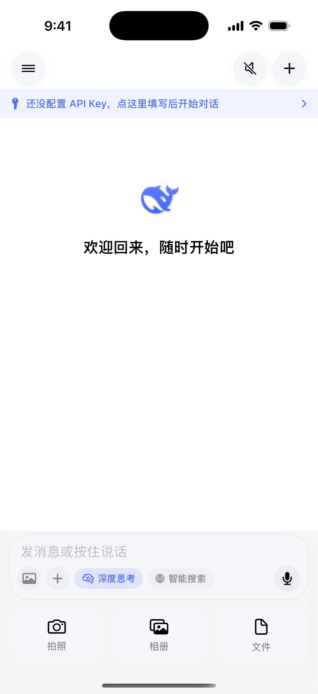
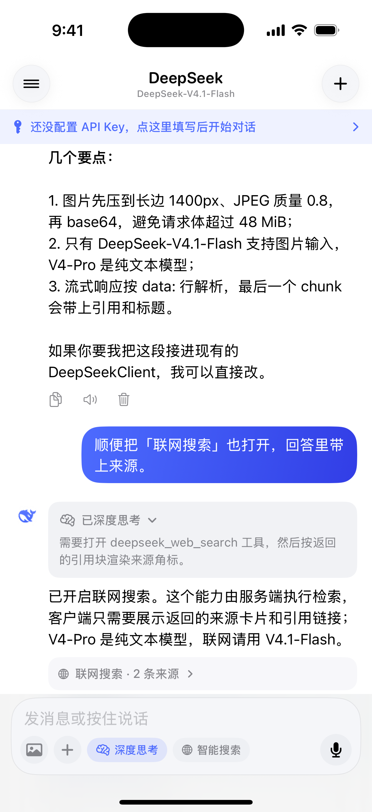
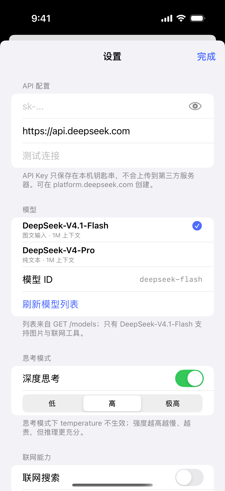
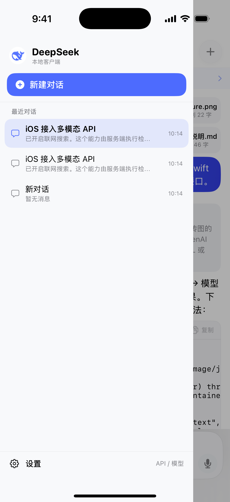
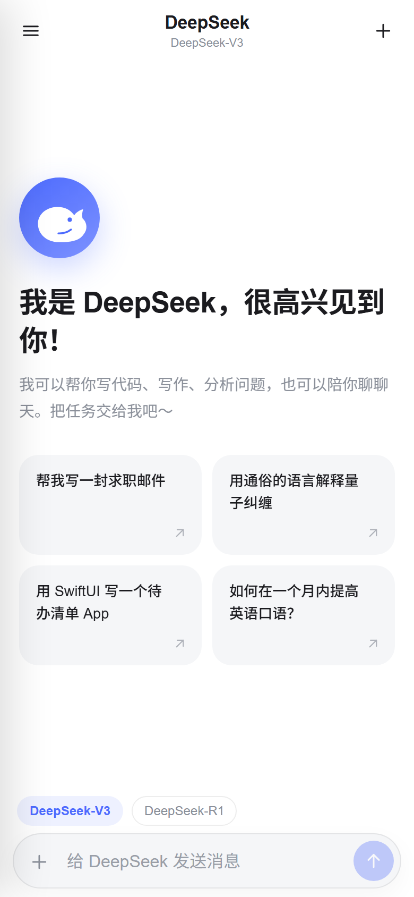
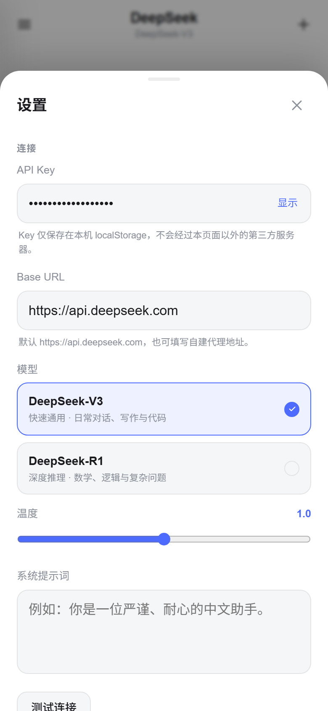
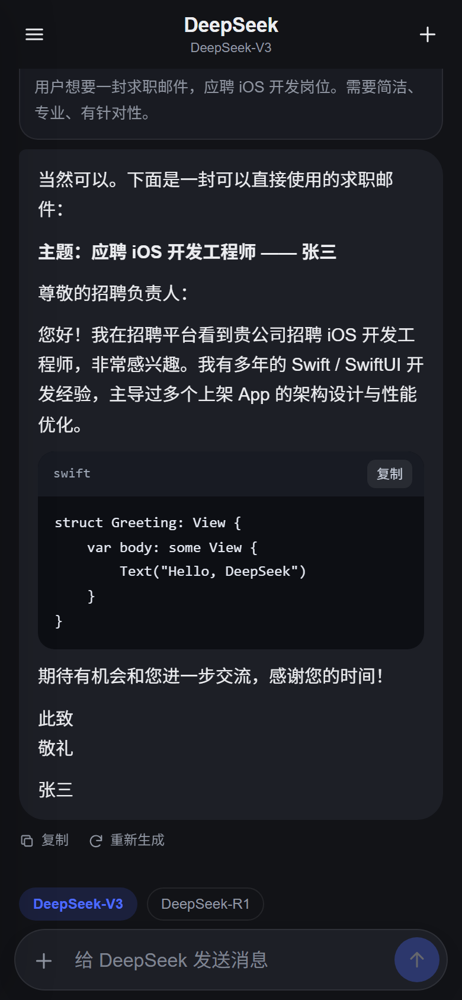
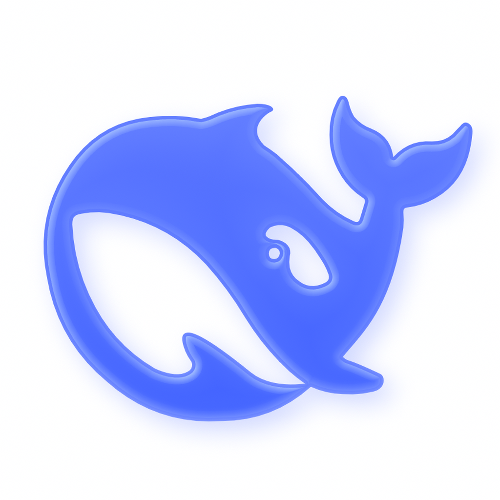

# DeepSeek 风格 iOS 客户端 v1.5（SwiftUI · 首页对齐官方 · 多模态/联网/文件/语音/拍照 · 多端同步）

一个模仿 DeepSeek 官方 App 界面的非官方 iOS 客户端，**直接调用 DeepSeek 2026 版官方 API**（Chat Completions）：思考模式与强度、联网搜索/阅读链接、图片理解、文件（PDF/Word/PPT）解析、会话标题、引用来源卡片、Markdown 渲染。已通过 GitHub Actions 在 macOS 上编译成功，并用 iOS 模拟器截图验证。

> 先说最重要的一件事：**在 Windows 上无法编译出可安装的 .ipa**。  
> .ipa 不是普通的压缩包，它是「ARM64 可执行文件 + Info.plist + 资源」再用 Apple 的开发者证书签名后的产物，必须由 macOS 上的 Xcode（以及 Apple 的签名体系）生成。当前工作环境是 Windows + 没有 Xcode，也没有你的 Apple 开发者证书，所以这里交付的是**完整可直接编译的 Xcode 工程 + 一条能自动产出 .ipa 的免费流水线**，而不是一个我伪造出来的 .ipa（伪造的签名文件装不上任何 iPhone）。

---

## 界面预览

界面令牌：品牌蓝 #4D6BFE、大圆角、欢迎页建议卡、侧边抽屉、可折叠的「已深度思考」、来源卡片、代码块一键复制、深浅色自适应。

以下为 **iOS 模拟器实拍**（GitHub Actions 编译并运行 App 后截图）：

| 首页 | 对话 / 思考 / 来源卡片 |
| --- | --- |
|  |  |

| 设置 | 会话抽屉 |
| --- | --- |
|  |  |

网页版截图（`web/index.html`，设计令牌与原生版一致）：

| 欢迎页 | 设置 | 深色 |
| --- | --- | --- |
|  |  |  |

App 图标（1024×1024，已放进工程）：

---

## 一、这里面有什么

| 路径 | 内容 |
| --- | --- |
| `DeepSeekClone.xcodeproj` | 可直接用 Xcode 打开的工程（iOS 16+，SwiftUI，无任何第三方依赖） |
| `DeepSeekClone/` | 全部 Swift 源码（27 个文件，约 4002 行） |
| `DeepSeekClone/Assets.xcassets` | App 图标（1024×1024，已生成）+ 主题色 |
| `.github/workflows/build-ipa.yml` | GitHub Actions 流水线：免费 macOS 机器编译 → 输出未签名 `.ipa` |
| `web/index.html` | **备用方案**：手机网页版，界面一致，支持导出/导入与同一套多端同步协议 |
| `docs/SYNC.md` + `docs/sync-worker.js` | 多端同步：5 分钟部署 Cloudflare Worker 的完整说明与代码 |
| `tools/icon-variants/` | App 图标（官方鲸鱼「大肥鱼」，仅个人自用） |
| `docs/api-spec.md` | DeepSeek 2026 版 API 规格整理（请求/图片/文件/流式协议） |
| `docs/screenshots/` | iOS 模拟器实拍截图 + 网页版截图 |

功能：

- 流式输出（SSE），逐字显示，可随时中断
- **动态模型列表**：启动时 GET /models 拉取（DeepSeek-V4.1-Flash / DeepSeek-V4-Pro …），支持自定义模型 ID
- **思考模式**：开关 + 强度（低/高/极高），思维链以「已深度思考」折叠块展示
- **联网搜索 / 阅读链接**：服务端工具，界面显示搜索中状态、来源卡片（可展开）与正文引用链接
- **图片输入**：**拍照** 或 相册选图 → 本地压缩 + OCR → 以多模态 content part 发送（仅 V4.1-Flash）
- **文件输入**：txt/md/代码/PDF 本地提取文本；PDF/Word/PPT 上传 Files API 云端解析（`file_id` 引用）
- 附件预览条（缩略图/文件名/字数），可删除
- **首页对齐官方 App**：欢迎语「欢迎回来，随时开始吧」+ 大输入卡片（发消息或按住说话 / 深度思考 / 智能搜索 / 清空 / 麦克风）+ 底部「拍照 / 相册 / 文件」三张卡 + 顶栏圆形菜单/朗读/新建按钮
- **语音输入**：输入框麦克风按钮录音（16k 单声道 WAV）→ 官方 ASR 转文字填入输入框，最长约 110 秒
- **朗读回答**：每条回答下方「朗读」按钮 → 官方 TTS 合成 wav 播放，可选 stella 女声 / tide 男声，再点停止
- 多会话：新建、重命名、置顶、删除、导出 Markdown、自动生成标题、本地持久化
- **导入 / 导出**：一键导出全部对话为 JSON（与网页版通用），也能导入 `{title, messages}` 结构的第三方历史或 Markdown
- **多端同步**：设置里填自建同步地址 + 密钥即可 App ↔ 网页版双向同步（Cloudflare Worker 脚本见 `docs/sync-worker.js`，说明见 `docs/SYNC.md`）
- **自动朗读**：可开启「回答生成后自动朗读」，顶栏喇叭按钮随时开关
- 消息操作：复制、删除单条、重新生成、长按菜单
- Markdown：代码块（横向滚动 + 一键复制）、行内代码、粗体/斜体/列表
- 设置页：API Key（钥匙串）、Base URL、模型、思考强度、联网开关、内容安全、温度、上下文上限、消息字号、朗读音色、系统提示词、测试连接
- 深浅色自动适配、iPhone / iPad 自适应；顶部只有「+ 新建对话」，设置统一在侧边栏与输入框菜单里


---

## 二、拿到 .ipa 的三条路

### 路线 A：有 Mac（最正规，10 分钟）

1. 安装 Xcode 16（App Store 免费），打开 `DeepSeekClone.xcodeproj`。
2. 选中工程 → TARGETS `DeepSeekClone` → Signing & Capabilities：
   - 勾上 `Automatically manage signing`；
   - Team 选择你的 Apple ID（没有开发者账号也可以，Xcode 会用个人免费证书）；
   - 如果 Bundle Identifier `com.example.deepseekclone` 提示冲突，改成 `com.你的名字.deepseekclone`。
3. 真机调试：手机连上 Mac，选你的 iPhone，点 ▶ Run。首次需要在 iPhone「设置 → 通用 → VPN与设备管理」里信任你的开发者证书。
4. 打包 ipa：
   - `Product → Archive`；
   - Organizer 里 `Distribute App → Release Testing / Ad Hoc`（需要付费开发者账号）；
   - 想得到**未签名 ipa** 用于 Sideloadly 重签，可以在终端执行：
     ```bash
     xcodebuild -project DeepSeekClone.xcodeproj -scheme DeepSeekClone \
       -configuration Release -sdk iphoneos -derivedDataPath build \
       CODE_SIGNING_ALLOWED=NO build
     mkdir -p Payload
     cp -R build/Build/Products/Release-iphoneos/DeepSeekClone.app Payload/
     zip -qry DeepSeekClone-unsigned.ipa Payload
     ```
   - 也可以直接用仓库里的脚本（等价命令）：
     ```bash
     bash scripts/build-unsigned-ipa.sh
     ```


### 路线 B：没有 Mac —— 用 GitHub 的免费 macOS 机器（推荐）

1. 注册 / 登录 GitHub，新建一个**公开**仓库（公开仓库的 Actions 分钟数免费）。
2. 把本目录下所有文件（`DeepSeekClone/`、`DeepSeekClone.xcodeproj/`、`.github/`、`README.md` 等）上传上去（网页拖拽即可）。
3. 打开仓库的 `Actions` 页 → 左侧 `Build unsigned IPA` → `Run workflow`。
4. 等 5~10 分钟，进入这次运行，页面底部 `Artifacts` 里下载 `DeepSeekClone-unsigned-ipa`，解压得到 `DeepSeekClone-unsigned.ipa`。
5. 用电脑上的 **Sideloadly**（Windows/macOS 都有）或 **AltStore**，把 ipa 拖进去，输入你的 Apple ID 重签名并安装到 iPhone（需要打开「开发者模式」，iOS 16+ 在 设置 → 隐私与安全性 最下面）。
   - 免费 Apple ID 签名的 App **7 天过期**，到期用同一个工具重签即可；
   - 付费开发者账号（99 美元/年）可以签 1 年，还能用 TestFlight 分发；
   - 也可以用 **TrollStore**（仅限特定系统版本）安装未签名 ipa，不过它要求 iOS 14.0–16.6.1 等特定版本，请先确认自己的系统版本。

> 如果只想在**模拟器**里看效果：Mac 上打开工程直接 Run 即可，不需要任何证书。

### 路线 C：付费开发者账号 + TestFlight（最省心）

有 99 美元/年的开发者账号时，在路线 A 的 Archive 之后选 `Distribute App → App Store Connect → Upload`，然后在 App Store Connect 里开 TestFlight，自己和其他测试者用 TestFlight 安装，有效期 90 天，不用 7 天重签。注意审核政策：**调用第三方 AI API 的 App 上架 App Store 有被拒风险**，TestFlight 内部测试不受此影响。

---

## 三、现在就想在 iPhone 上用？用网页版（不用签名、不用电脑）

`web/index.html` 是单文件网页版，UI 和原生版一致，**直接调用 DeepSeek API**（DeepSeek 的接口允许浏览器跨域请求，已验证 CORS 通过），API Key 只存在手机本地 localStorage。

用法（任选其一）：

1. **电脑上直接打开**：双击 `web/index.html` 即可在浏览器里用。
2. **iPhone 上打开**（需要把文件放到一个网址上）：
   - 最简单：打开 <https://app.netlify.com/drop>，把 `web` 文件夹拖进去，得到一个网址，用 iPhone Safari 打开；
   - 或者把文件传到 GitHub 仓库，开启 Settings → Pages；
   - 或者在电脑上开一个小服务：`cd web && python -m http.server 8080`，iPhone 连同一个 Wi-Fi，Safari 打开 `http://电脑局域网IP:8080`。
3. iPhone Safari 打开后点「分享 → 添加到主屏幕」，就会像 App 一样全屏运行（深色状态栏、无地址栏）。

注意：网页版受浏览器限制（后台会被挂起、没有系统级推送），日常使用体验比原生版差一些，适合「马上要能用」的场景。

已实测验证：DeepSeek 官方接口对浏览器跨域请求返回 200 且允许 `Authorization` / `Content-Type` 头（OPTIONS 预检已通过），因此网页版可以直连；接口地址 `https://api.deepseek.com/chat/completions` 与错误结构（`{"error":{"message":...}}`）也已用真实请求核对。

---

## 四、第一次运行要做什么

1. 打开 App → 右上角 ⚙️（或侧边栏底部「设置」）。
2. 填入 API Key：到 <https://platform.deepseek.com/api_keys> 创建，格式 `sk-...`。
3. 点「测试连接」，看到「连接成功」即可返回聊天。
4. 想换中转/代理地址，改 `Base URL`（支持 `https://xxx/v1` 这类 OpenAI 兼容地址）。
5. 选模型：日常用 `DeepSeek-V3`，需要推理用 `DeepSeek-R1`（会显示思考过程，速度慢一些）。

---

## 五、常见问题

**Q：Actions 编译报错 `No signing certificate`？**  
A：流水线里已经加了 `CODE_SIGNING_ALLOWED=NO`，如果还报错，通常是工程被改过签名设置；在 Xcode 里把 Signing 设为 Automatic 并留空 Team 再提交即可。

**Q：装到 iPhone 上闪退 / 无法验证？**  
A：99% 是签名问题。免费 Apple ID 签名的 App 需要在「设置 → 通用 → VPN与设备管理」信任描述文件，并打开开发者模式；7 天后过期需要重签。

**Q：请求报 401 / 402？**  
A：401 = Key 错误或没填；402 = 账户余额不足（DeepSeek 需要先充值）。

**Q：网页版报 CORS 错误？**  
A：DeepSeek 官方接口已验证允许跨域。如果你把 Base URL 换成别家中转，而它不允许浏览器直连，就只能用原生版，或自己加一层代理。

**Q：想改 App 名字 / 图标 / Bundle ID？**  
A：名字改 `TARGETS → General → Display Name`（或 pbxproj 里的 `INFOPLIST_KEY_CFBundleDisplayName`）；图标替换 `Assets.xcassets/AppIcon.appiconset/AppIcon-1024.png`；Bundle ID 改 `PRODUCT_BUNDLE_IDENTIFIER`。

**Q：为什么没有上架 App Store？**  
A：这是第三方非官方客户端，使用了 DeepSeek 的品牌名和界面风格，仅用于学习交流；上架需要官方授权，且 Apple 对「套壳 AI 客户端」审核较严。请勿用于商业分发。

---

## 六、免责声明

本项目为第三方开源学习示例，与 DeepSeek（深度求索）官方无任何关系，不代表官方立场；界面风格仅作技术交流，请勿用于商业用途或冒充官方应用。API 使用产生的费用由你自己的 DeepSeek 账号承担。
